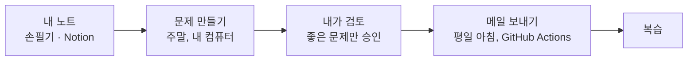
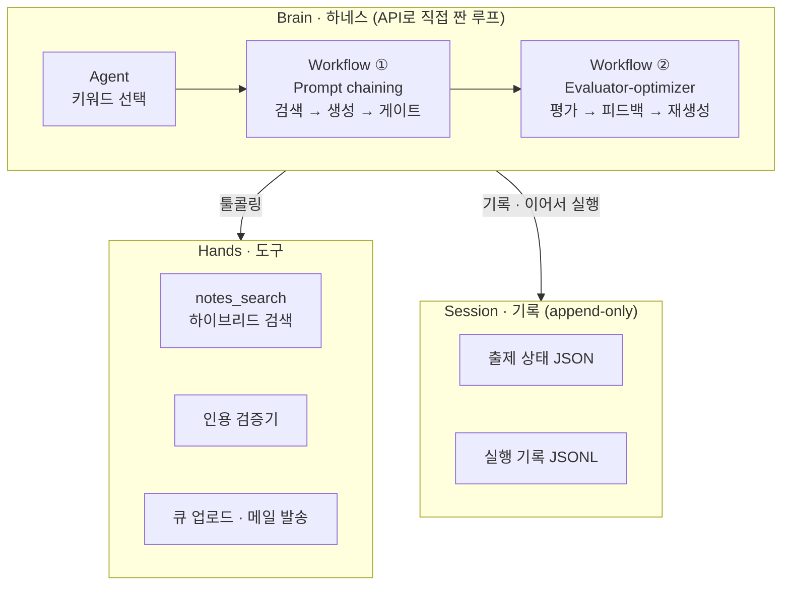

# 차곡 (chagok)

> 정리한 학습 노트로 평일마다 복습 문제 하나. 배운 내용을 머릿속에 차곡차곡.

내가 공부한 노트로 복습 문제를 만들어, 평일마다 하루 1문제를 메일로 보내는 서비스입니다.

| 질문 | 답 |
| --- | --- |
| 무엇을 만드나 | 노트 근거로만 만든 복습 문제(질문 + 답 + 원문 인용 + 꼬리질문)를 평일 하루 1통 메일로 |
| 어떻게 짜나 | Anthropic 엔지니어링 블로그의 구조 개념대로. **Augmented LLM**을 기본 부품으로, **Workflow 2개**(Prompt chaining, Evaluator-optimizer)와 **Agent 1개**를 얹고, **Brain · Hands · Session**을 분리 |
| 무엇을 보여주나 | 에이전틱 RAG, RAG 최적화, 툴콜링·평가, 멀티모달 전처리 |
| 무엇을 숫자로 답하나 | "노트가 얼마나 쌓여야 RAG가 필요한가?" (교차점 실험) |
| 무엇을 하지 않나 | 답 제출·채점·오답 관리, 멀티 에이전트, 프레임워크, 서버에서 LLM 실행 |

## 아키텍처

- **출제 흐름**: 키워드 선택 → 하이브리드 검색 → 원문 인용 기반 생성 → 코드 게이트(인용문이 원문에 있는지) → 분리된 평가자 → 사람 검토
- **평가**: 검색과 생성을 따로 잰다. 회귀 평가셋(Hit@5 유지, PR마다 CI) / 능력 평가셋(MRR 상승)

자세한 설계와 근거 글은 [`docs/PLAN.md`](docs/PLAN.md).

## 기술 스택

| 역할 | 도구 |
| --- | --- |
| 언어 · 환경 | Python, uv |
| Brain | Claude API (툴콜링, 구조화된 출력, extended thinking, 프롬프트 캐싱) |
| 임베딩 · 벡터DB | bge-m3 · Chroma |
| 키워드 검색 | BM25 + kiwi |
| 검토 화면 | Streamlit |
| 발송 · CI | GitHub Actions |

## 원칙

- 노트에 없는 내용은 출제하지 않는다. 답에는 원문 인용을 붙이고, 인용할 수 없으면 출제하지 않는다.
- 모든 모듈은 켰을 때 / 껐을 때를 수치로 비교한 뒤 채택한다. 결과는 [`docs/DECISIONS.md`](docs/DECISIONS.md).

## 진행 상황

| Phase | 내용 | 상태 |
| --- | --- | --- |
| 0 | 노트 형식 | 완료 |
| 1 | 기본 RAG · 평가셋 · CI | 진행 중 |
| 2 | RAG 최적화 (kiwi 사용자 사전, 하이브리드, 청크 맥락) | 대기 |
| 3 | Workflow (인용 기반 생성, 평가자) | 대기 |
| 4 | 교차점 실험, Agent vs 랜덤 | 대기 |
| 5 | 평일 발송 | 대기 |

자세한 기록은 [`docs/STATUS.md`](docs/STATUS.md).

## 문서

- [`CLAUDE.md`](CLAUDE.md): 프로젝트 기준 문서 (원칙, 아키텍처, 컨벤션)
- [`docs/PLAN.md`](docs/PLAN.md): 기획안 (아키텍처, 출제 흐름, 평가, 실험, 근거 글)
- [`docs/DESIGN.md`](docs/DESIGN.md): 목표치·제약·평가자 기준표
- [`docs/DECISIONS.md`](docs/DECISIONS.md): 실험 결과와 채택 결정
- [`docs/STATUS.md`](docs/STATUS.md): 진행 상황
