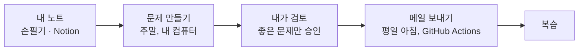
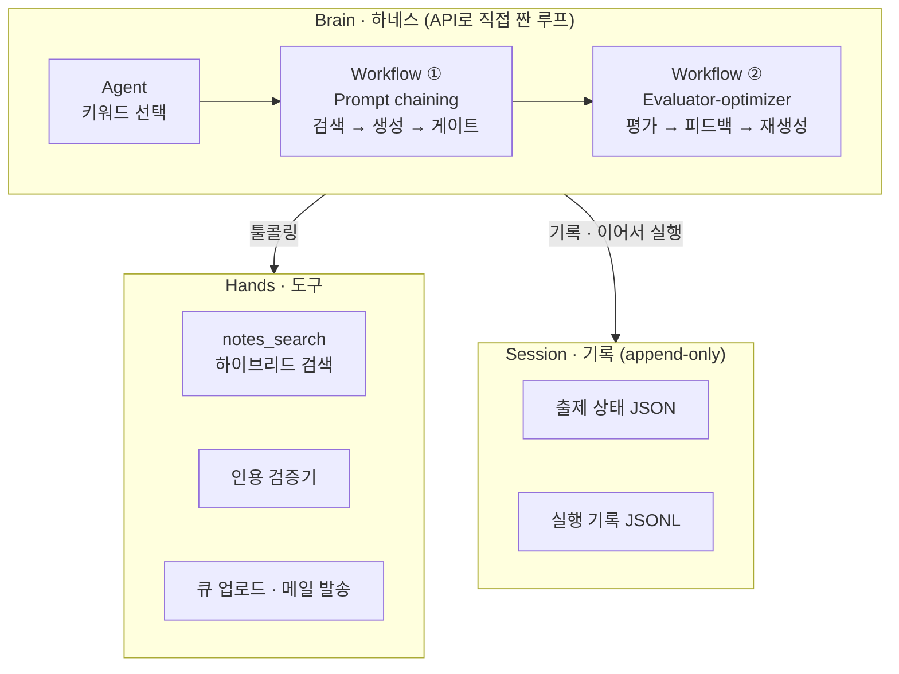
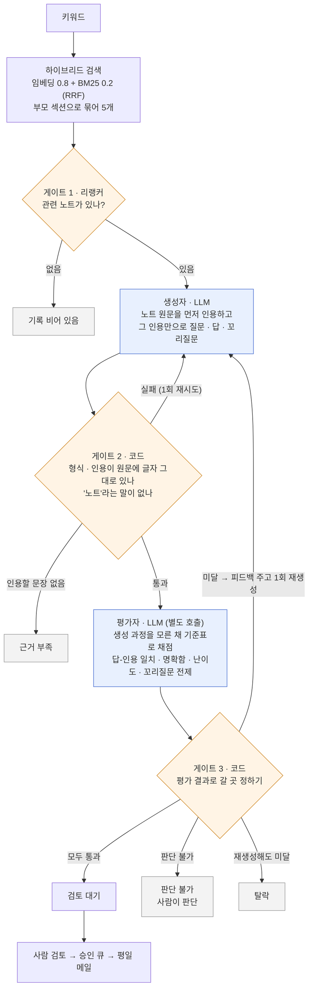

# 차곡 (chagok)

> 정리한 학습 노트로 평일마다 복습 문제 하나. 배운 내용을 머릿속에 차곡차곡.

내가 공부한 노트로 복습 문제를 만들어, 평일마다 하루 1문제를 메일로 보내는 서비스입니다.

| 질문 | 답 |
| --- | --- |
| 무엇을 만드나 | 노트 근거로만 만든 복습 문제(질문 + 답 + 원문 인용 + 꼬리질문)를 평일 하루 1통 메일로 |
| 어떻게 짜나 | Anthropic 엔지니어링 블로그의 구조 개념대로. **Augmented LLM**을 기본 부품으로, **Workflow 2개**(Prompt chaining, Evaluator-optimizer)와 **Agent 1개**를 얹고, **Brain · Hands · Session**을 분리 |
| 무엇을 보여주나 | 에이전틱 RAG, RAG 최적화, 툴콜링·평가, 멀티모달 전처리 |
| 무엇을 숫자로 답하나 | "노트가 얼마나 쌓여야 RAG가 필요한가?" (교차점 실험) |
| 무엇을 하지 않나 | 답 제출·채점·오답 관리, 멀티 에이전트, 프레임워크, 서버에서 LLM 실행 |

## 아키텍처

## 출제 흐름

문제 하나가 만들어지는 길입니다. 네모는 LLM, 마름모는 코드 게이트입니다. LLM 호출은 문제당 최대 5번입니다.

| 단계 | 누가 | 하는 일 |
| --- | --- | --- |
| 검색 | 코드 | 키워드와 가까운 노트 섹션을 찾고, 같은 부모 섹션은 하나로 묶는다 |
| 게이트 1 | 코드 (리랭커) | 관련 노트가 없으면 출제하지 않는다 |
| 생성자 | LLM | 원문을 먼저 인용하고, 그 인용만으로 문제를 만든다. 두 가지까지만 묻는다 |
| 게이트 2 | 코드 | 인용이 원문에 글자 그대로 있는지 직접 대조한다. 실패하면 1회 다시 |
| 평가자 | LLM | 생성자와 따로 부른다. 기준표 4개 항목을 통과 / 미달 / 판단 불가로 매기고 고칠 점을 준다 |
| 게이트 3 | 코드 | 통과면 검토 대기, 미달이면 피드백으로 1회 재생성, 또 미달이면 탈락 |

생성자와 평가자는 같은 기준표(`docs/DESIGN.md`)를 봅니다. 몇 번 다시 만들지, 언제 멈출지는 LLM이 아니라 코드가 정합니다.

## 지금 숫자

| 항목 | 값 | 목표 |
| --- | --- | --- |
| 검색 · 회귀 평가셋 Hit@5 (70문항) | 100% | 100% 유지 |
| 검색 · 능력 평가셋 MRR (19문항) | 0.71 | 새 모듈은 이보다 올라야 채택 |
| 생성 · 인용 일치율 | 100% | 100% |
| 생성 · 사람 승인율 (키워드 10개) | 90% | 90% 이상 |
| 평가자-사람 일치율 | 10/10 | 90% 이상 |
| 문제당 비용 · 시간 | 약 60원 · 평균 10초 | LLM 호출 5번 이하 |

검색과 생성을 따로 잽니다. 회귀 평가셋은 PR마다 CI가 돌립니다. 실험마다 품질·속도·비용을 [`docs/DECISIONS.md`](docs/DECISIONS.md)에 남깁니다.

자세한 설계와 근거 글은 [`docs/PLAN.md`](docs/PLAN.md).

## 기술 스택

| 역할 | 도구 |
| --- | --- |
| 언어 · 환경 | Python, uv |
| Brain | Claude API (툴콜링, 구조화된 출력, extended thinking, 프롬프트 캐싱) |
| 임베딩 · 벡터DB | bge-m3 · Chroma |
| 키워드 검색 | BM25 + kiwi |
| 검토 화면 | Streamlit |
| 발송 · CI | GitHub Actions |

## 원칙

- 노트에 없는 내용은 출제하지 않는다. 답에는 원문 인용을 붙이고, 인용할 수 없으면 출제하지 않는다.
- 모든 모듈은 켰을 때 / 껐을 때를 수치로 비교한 뒤 채택한다. 결과는 [`docs/DECISIONS.md`](docs/DECISIONS.md).

## 진행 상황

| Phase | 내용 | 상태 |
| --- | --- | --- |
| 0 | 노트 형식 | 완료 |
| 1 | 기본 RAG · 평가셋 · CI | 완료 |
| 2 | RAG 최적화 (하이브리드, 리랭커 게이트, Parent Document) | 완료 |
| 3 | Workflow (인용 기반 생성, 평가자, 검토 화면) | 진행 중 |
| 4 | 교차점 실험, Agent vs 랜덤 | 대기 |
| 5 | 평일 발송 | 대기 |

자세한 기록은 [`docs/STATUS.md`](docs/STATUS.md).

## 문서

- [`CLAUDE.md`](CLAUDE.md): 프로젝트 기준 문서 (원칙, 아키텍처, 컨벤션)
- [`docs/PLAN.md`](docs/PLAN.md): 기획안 (아키텍처, 출제 흐름, 평가, 실험, 근거 글)
- [`docs/DESIGN.md`](docs/DESIGN.md): 목표치·제약·평가자 기준표
- [`docs/DECISIONS.md`](docs/DECISIONS.md): 실험 결과와 채택 결정
- [`docs/STATUS.md`](docs/STATUS.md): 진행 상황
