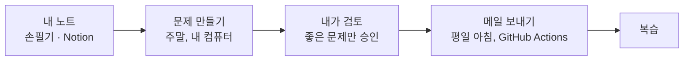
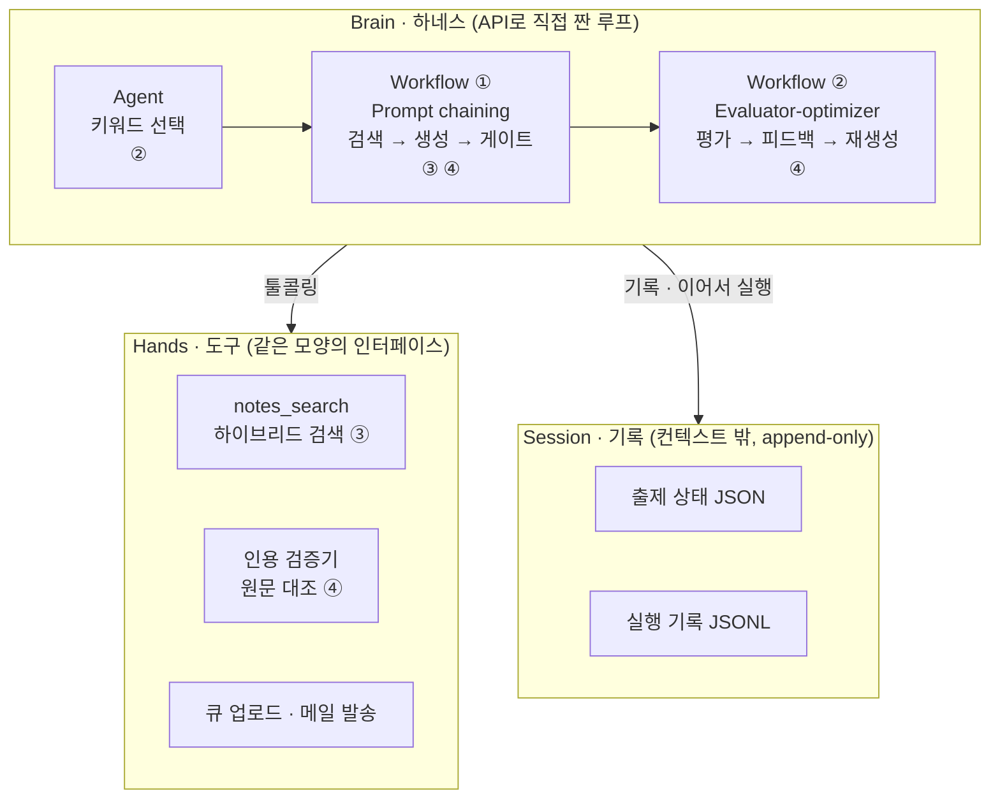
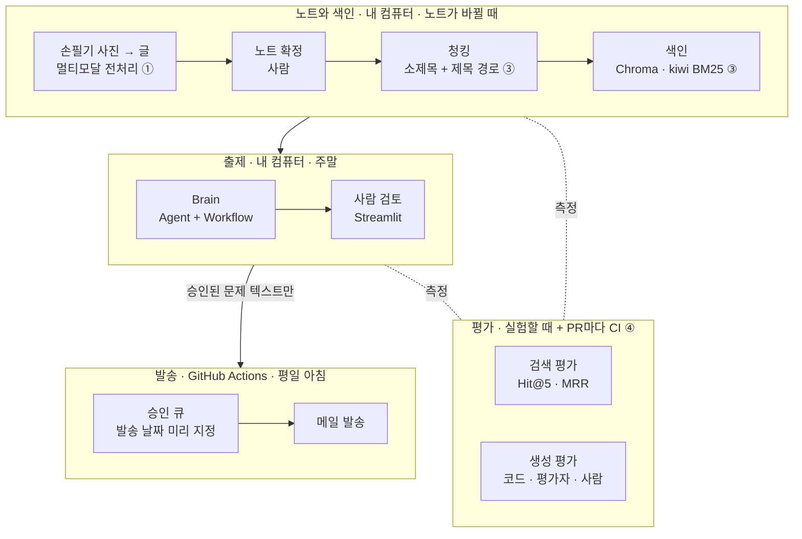
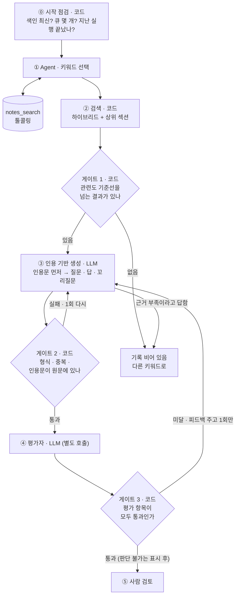
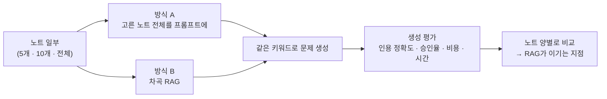
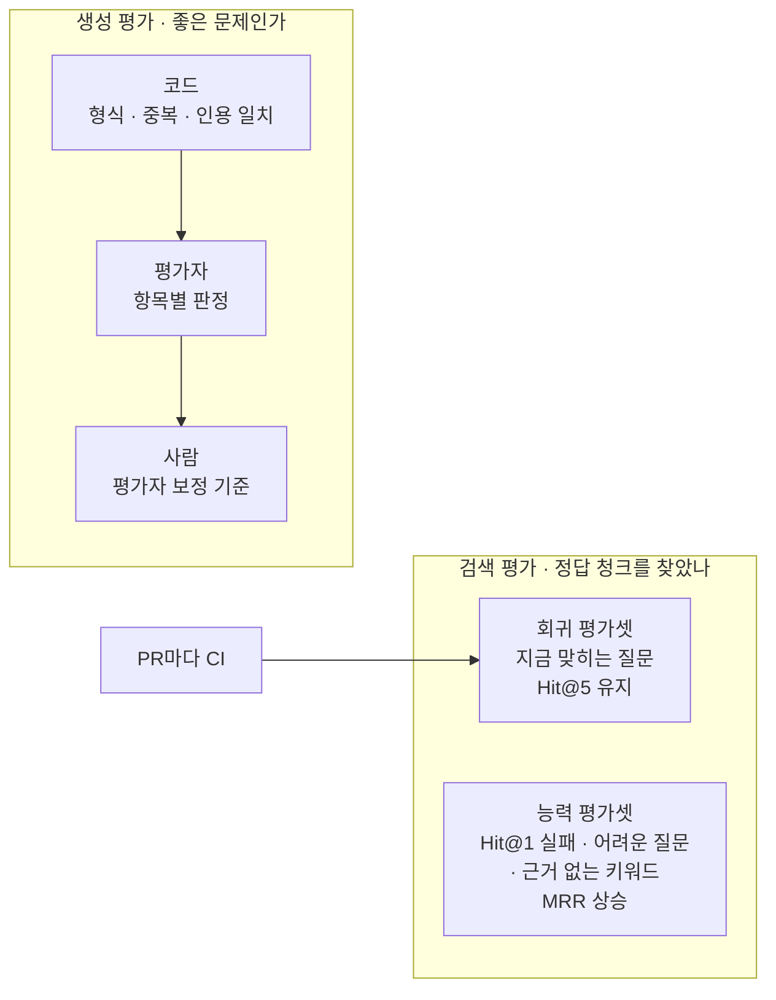
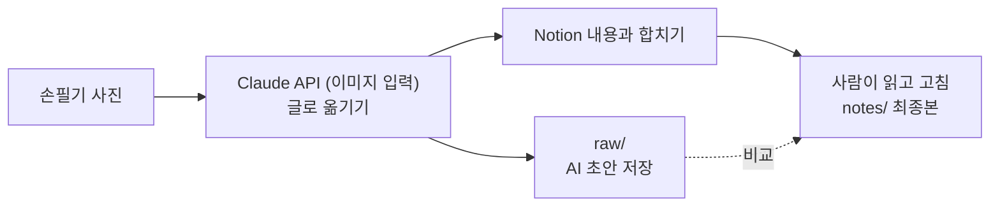
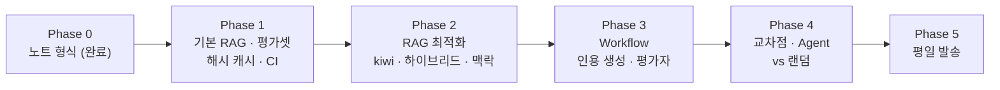

# 차곡 기획안 v7

> 2026-10-23 작성. **Anthropic 엔지니어링 블로그가 말하는 아키텍처 개념으로 처음부터 다시 짠 안**이다.
> 장 이름부터 블로그 용어를 쓰고, 장마다 근거 글을 붙였다. 핵심 키워드 7개 중 4개(①②③④)를 각 장에 녹였다.
>
> 2026-10-23 이슈 #17에서 CLAUDE.md·DECISIONS.md·STATUS.md에 반영했다. DESIGN.md는 사람이 반영한다. 그림은 Mermaid로 그렸다 (GitHub, Notion에서 그림으로 보인다).
> 용어 설명은 맨 뒤 **부록 A**에 있다.

---

## 0. 한 장 요약

**차곡은 내가 공부한 노트로 복습 문제를 만들어, 평일마다 하루 1문제를 메일로 보내는 서비스다.**



| 질문 | 답 |
| --- | --- |
| 무엇을 만드나 | 노트 근거로만 만든 복습 문제(질문 + 답 + 원문 인용 + 꼬리질문)를 평일 하루 1통 메일로 |
| 어떻게 짜나 | Anthropic 블로그의 구조 개념 그대로 짠다. **Augmented LLM**을 기본 부품으로, **Workflow 2개**(Prompt chaining, Evaluator-optimizer)와 **Agent 1개**를 얹고, **Brain · Hands · Session**을 분리한다 |
| 무엇을 보여주나 | 핵심 키워드 ② 에이전틱 RAG, ③ RAG 최적화, ④ 툴콜링·평가 + ① 멀티모달 전처리 |
| 무엇을 숫자로 답하나 | "노트가 얼마나 쌓여야 RAG가 필요한가?" (교차점 실험) |
| 무엇을 하지 않나 | 답 제출·채점·오답 관리, 멀티 에이전트, 프레임워크, 서버에서 LLM 실행 |

---

## 1. 설계 철학: Anthropic이 말하는 것 → 차곡의 결정

> **요약:** 필요한 것만 만들고, 넣을 때마다 숫자로 확인하고, 안 되면 뺀다.

### 1-1. 블로그 전체를 관통하는 한 문장

> **"하네스의 모든 구성 요소는 '모델이 혼자서는 못한다'는 가정이다. 그 가정을 측정으로 확인하고, 필요 없으면 뺀다."**
> (Harness design for long-running apps, Scaling Managed Agents)

### 1-2. Building effective agents의 세 원칙

| 원칙 | 블로그가 말하는 것 | 차곡의 결정 |
| --- | --- | --- |
| **Simplicity** | 가장 단순한 해법부터. 검색과 예시를 붙인 LLM 호출 하나로 충분한 경우가 많다. 복잡도는 수치로 좋아질 때만 더한다 | Agent는 1곳만. "노트 통째로 넣기"와도 경쟁시킨다. 프레임워크 없이 API로 직접 짠다 |
| **Transparency** | 에이전트의 계획 단계를 드러낸다 | Agent는 키워드와 **이유**를 출력한다. 모든 호출·도구·판정을 실행 기록에 남기고 직접 읽는다 |
| **ACI** (Agent-Computer Interface) | 도구 설명과 테스트에 사람용 UI만큼 공을 들인다. 실수하기 어렵게(poka-yoke) 만든다 | 도구는 `notes_search` 1개. 사람이 읽는 경로를 돌려주고, 빈 결과에도 다음 행동을 안내한다 |

### 1-3. 절대 원칙 (이 철학을 차곡의 규칙으로)

1. 평가셋을 먼저 만들고, 한 번에 하나만 바꾼다. 검색과 생성은 따로 잰다.
2. 품질에 영향을 주는 모듈은 켬/끔을 수치로 비교한 뒤에만 넣는다. 채택 기준은 실험 전에 정한다. 돈이 드는 선택은 2개 이상 비교한다.
3. 검색이 목표치를 넘기 전에 출제를 만들지 않는다. 결과가 이상하면 검색부터 본다.
4. 질문·답·꼬리질문의 근거는 노트에만 둔다. 답에는 원문 인용을 붙이고, 인용할 수 없으면 출제하지 않는다.
5. 평가셋, 품질 기준(평가자 기준표), 목표치는 사람만 고친다.
6. 노트는 내가 손으로 공부한 내용과 Notion 질문을 바탕으로 한다. Claude는 사진을 글로 옮기고 합치는 일만 하며, 처음 옮긴 글은 따로 저장한다.
7. 평가셋 실패 사례를 보고 고친 변경은, 그 사례를 뺀 질문으로도 효과를 확인한다.
8. 프롬프트·캐시·모델을 바꾸면 회귀 평가를 다시 돌린다. 통과 못 하면 되돌린다.

---

## 2. 아키텍처: Anthropic 개념으로 조립한 차곡

> **요약:** Brain · Hands · Session을 분리한다. Brain 안에는 키워드를 고르는 Agent 1개와, 문제를 만드는 Workflow 2개(Prompt chaining, Evaluator-optimizer)가 있다.

### 2-1. 전체 그림



| Anthropic 개념 | 뜻 | 차곡에서 | 키워드 | 근거 글 |
| --- | --- | --- | --- | --- |
| **Augmented LLM** | 검색·도구·기억을 붙인 LLM. 모든 호출의 기본 부품 | Claude + `notes_search` + 출제 상태 | ③ ④ | Building effective agents |
| **Workflow: Prompt chaining + 게이트** | 정해진 순서로 LLM을 잇고, 단계 사이를 코드로 검사 | 검색 → 인용 기반 생성 → 게이트 3개 | ③ ④ | Building effective agents |
| **Workflow: Evaluator-optimizer** | 만드는 LLM과 평가하는 LLM을 나누고 피드백으로 고친다 | 분리된 평가자 → 피드백 → 1회 재생성 | ④ | Building effective agents, Harness design |
| **Agent** | 환경 결과를 보며 도구를 고르는 루프. 종료 조건 필수 | 키워드 선택 1곳 | ② | Building effective agents |
| **Brain · Hands · Session** | 판단(루프)·실행(도구)·기록(로그)을 서로 모르게 분리 | 하네스 / 도구·발송 / 상태·기록 | | Scaling Managed Agents |
| **Context engineering** | 컨텍스트에 넣는 토큰을 최소·고신호로 고른다 | RAG 검색, 프롬프트 배치, 예시 | ③ | Effective context engineering |

**이렇게 나누면 좋은 점**

- **Brain은 stateless다.** 하네스가 중간에 멈춰도 Session(출제 상태)을 읽고 끝난 문제는 건너뛰어 이어서 돈다.
- **Hands는 교체 가능하다.** 검색 방식이나 메일 서비스를 바꿔도 Brain 코드는 그대로다.
- **Session은 컨텍스트 창이 아니다.** 실행 기록은 LLM에 넣지 않고 파일로 남겨, 사람이 읽고 개선한다.
- **비밀 값은 Hands에만.** 메일 키는 발송 작업에만 있고, LLM은 키를 볼 수 없다.

### 2-2. 쓰는 패턴과 쓰지 않는 패턴

| 패턴 | 쓰나 | 이유 |
| --- | --- | --- |
| Prompt chaining + 게이트 | ✅ | 출제는 단계가 정해진 작업이다 |
| Evaluator-optimizer | ✅ (실험으로 확인) | 기준이 분명할 때 효과가 있다. 켬/끔으로 증명한다 |
| Agent | ✅ 1곳 | 키워드 선택만 단계 수가 정해지지 않는다 |
| Routing | ❌ | 입력이 "키워드 하나" 한 종류뿐이다 |
| Parallelization | ❌ | 주 5문제라 속도 이득이 없다. 평가자 정확도가 부족하면 "항목별 따로 채점"으로 다시 본다 |
| Orchestrator-workers · 멀티 에이전트 | ❌ | 하위 작업이 정해져 있고 토큰이 약 15배 든다 (Multi-agent research system) |

### 2-3. 실행 위치: 언제, 어디서 도나



| 영역 | 언제 | 어디서 | 하는 일 |
| --- | --- | --- | --- |
| 노트와 색인 | 노트가 바뀔 때 | 내 컴퓨터 | 사진을 글로 옮기고, 소제목 단위로 잘라 바뀐 청크만 색인 |
| 출제 | 주말 | 내 컴퓨터 | Brain이 문제 5개를 만들고, 내가 검토 |
| 발송 | 평일 아침 | GitHub Actions | 오늘 날짜 문제를 메일로. LLM·API 키 없음 |
| 평가 | 실험할 때, PR마다 | 내 컴퓨터 + CI | CI는 검색 회귀 평가만 (LLM 호출 없음) |

---

## 3. Workflow: 출제 흐름 (Prompt chaining + Evaluator-optimizer)

> **요약:** 검색 → 인용 기반 생성 → 코드 게이트 → 분리된 평가자 채점. 미달이면 피드백을 주고 1회만 재생성한다.



| 단계 | 패턴 | 누가 | 하는 일 |
| --- | --- | --- | --- |
| ⓪ 시작 점검 | 하네스 | 코드 | 색인 최신 여부, 큐 상태, 지난 실행 상태 확인 (Effective harnesses) |
| ① 키워드 선택 | Agent | LLM | 4장 |
| ② 검색 | Prompt chaining | 코드 | 하이브리드 검색 + 상위 섹션 (5장) |
| 게이트 1 | 게이트 | 코드 | 관련도 기준선 아래면 "기록 비어 있음" |
| ③ 인용 기반 생성 | Prompt chaining | LLM | 노트 원문 인용 → 질문·답·꼬리질문. 못 만들면 "근거 부족" |
| 게이트 2 | 게이트 | 코드 | 형식, 중복(기존 문제와 임베딩 유사도), **인용문이 원문에 글자 그대로 있는지** |
| ④ 평가자 | Evaluator-optimizer | LLM | 생성 대화를 보지 않는 별도 호출. 항목별 통과/미달 (7장) |
| 게이트 3 | 게이트 | 코드 | 모두 통과 → 사람 검토. 미달 → 피드백 주고 1회 재생성. "판단 불가" → 표시 후 사람에게 |
| ⑤ 사람 검토 | | 나 | 질문 품질만 본다 (11장) |
| ⑥ 업로드 | Hands | 코드 | 섞어서 발송 날짜를 붙여 큐에 올린다 |

**인용 기반 생성** (공식 문서 Reduce hallucinations)
- "모른다"고 해도 된다고 허용한다 → "근거 부족" 선택지
- 원문을 먼저 인용하고, 그 인용만으로 답을 만든다
- 인용을 못 하는 주장은 뺀다

**인용문 검증은 코드가 한다** (Demystifying evals: 결정적인 코드 채점을 먼저)
- 대조 전에 연속 공백·줄바꿈을 하나로, 마크다운 기호를 뺀다
- 출처 경로가 오면 그 경로의 원문과만 대조한다

**구조화된 출력 (Structured outputs)**

| 단계 | 받는 필드 |
| --- | --- |
| 키워드 선택 | 키워드, 이유 |
| 문제 생성 | 상태(생성/근거 부족), 인용문 1~3개(각 출처 경로), 질문, 답, 꼬리질문 |
| 평가자 | 항목별 판정(통과/미달/판단 불가)과 이유, 피드백 |

> Citations API는 출제에 쓰지 않는다. 구조화된 출력과 함께 쓸 수 없다(400 오류). 출처 표시가 핵심인 Q&A 도우미를 만들 때 쓴다.

---

## 4. Agent: 키워드 선택 — ② 에이전틱 RAG

> **요약:** "이번 주에 무엇을 낼까"만 Agent가 판단한다. 툴콜링으로 노트를 검색해 근거가 충분한 키워드를 고른다. 랜덤보다 나은지는 실험으로 확인한다.

### 왜 여기만 Agent인가 (Building effective agents)

- Agent는 **단계 수를 미리 정할 수 없는 열린 문제**에 쓴다.
- 검색·생성·채점은 키워드가 정해지면 할 일이 정해진다 → Workflow로 충분하다.
- 키워드 선택은 "지금 무엇을 내야 복습에 좋은가"를 여러 정보로 판단하고, 근거가 부족하면 다른 후보를 찾아야 한다 → Agent가 필요하다.
- 그래도 랜덤보다 나은지는 **실험으로 증명**한다. 못 이기면 랜덤을 쓴다.

### 설계

| 항목 | 내용 | 근거 |
| --- | --- | --- |
| 입력 | 안 낸 키워드 후보 10개(코드가 추림), 거절 사유, 노트별 출제 횟수, `> 궁금:` 표시 | Context engineering |
| 도구 | `notes_search` 1개 (6장) | Writing effective tools |
| 추론 | extended thinking. 별도 think 도구는 만들지 않는다 | The "think" tool (업데이트) |
| 출력 | 키워드 + 이유 (투명성) | Building effective agents |
| 구현 | 프레임워크 없이 Claude API로 루프를 직접 짠다. LangGraph는 같은 루프를 옮겨 보는 비교 대상으로만 둔다 | Building effective agents |

### 루프 통제

| 요소 | 내용 | 근거 |
| --- | --- | --- |
| 종료 조건 | 도구 호출 최대 3회. 넘으면 검색 점수가 가장 높은 후보로 코드가 정한다 | Building effective agents |
| 예산 | 문제당 LLM 호출 최대 10번. 토큰 상한은 실측의 2배 | Multi-agent research system |
| 실패 처리 | 타임아웃은 재시도. 실패 사실은 Agent에게 알려 다른 길을 찾게 한다 | Multi-agent research system |

### 비교 지표 (랜덤 vs Agent)

승인율, "너무 쉬움" 거절 비율, 노트별 고른 정도, 문제당 도구 호출 수·토큰·비용.

---

## 5. Context engineering: 검색과 프롬프트 — ③ RAG 최적화

> **요약:** 컨텍스트에 넣을 노트를 최소·고신호로 고른다. RAG는 그 핵심 수단이다.

### 5-1. 먼저 물어야 할 것: RAG가 필요한가?

Anthropic은 지식이 **20만 토큰(약 500쪽) 미만이면 RAG 없이 전부 프롬프트에 넣어도 된다**고 한다 (Contextual Retrieval). 반대로 컨텍스트가 길수록 정확도가 서서히 떨어진다(context rot)고도 한다 (Effective context engineering). 차곡의 노트는 지금 그 근처라, **두 방식을 경쟁시켜 교차점을 찾는다.**



| 항목 | 내용 |
| --- | --- |
| 노트 양 | 5개 · 10개 · 전체. 토큰 수로 기록. 노트가 쌓이면 다시 돌린다 |
| 키워드 | 단계마다 그 단계 노트에서 10개. 두 방식에 같은 키워드 |
| 사람 판정 | 단계·방식마다 5문제씩, **어느 방식인지 가리고** (총 30문제) |
| 결과 처리 | "지금은 통째로가 낫다"여도 기록한다. 그때는 통째로 넣기로 두고, 교차점을 넘으면 RAG로 바꾼다 |

### 5-2. RAG 설계 (공식 RAG 쿡북 + Contextual Retrieval)

| 단계 | 내용 | 상태 |
| --- | --- | --- |
| 청킹 | 소제목 단위 + `파일 > 상위 제목 > 소제목` 경로를 앞에 붙인다. id는 `파일#소제목 경로` | ✅ |
| 해시 캐시 | 내용이 같으면 다시 임베딩하지 않는다 | ✅ |
| 임베딩 | bge-m3 (로컬·무료·한국어). Voyage는 비교 후보 | ✅ |
| 키워드 검색 | **kiwi 형태소 분석 BM25** + 사용자 사전(`terms.yaml`) | ✅ + 실험 |
| 하이브리드 | **BM25(단어 일치) + 임베딩(뜻 비슷)**을 **RRF**로 합친다. 가중치를 실험한다 (쿡북 기본 0.8 : 0.2) | ✅ + 실험 |
| 작게 찾고 크게 넣기 | **Parent Document Retriever**. 작은 청크로 정확히 찾고, 넣을 때는 상위 섹션까지 넣어 맥락을 살린다. 넣는 개수 K = 3·5·10 비교 | ✅ + 실험 |
| 메타데이터 필터링 | 날짜·노트·`> 궁금:`을 저장하고, Agent 도구의 필터로 쓴다 | ✅ |
| 관련도 기준선 | 검색은 관련 없어도 항상 무언가를 돌려준다. 점수가 기준선 아래면 "결과 없음"으로 본다 | ✅ + 실험 |
| 청크 맥락 | **Contextual Retrieval**. 조각만 떼면 무슨 이야기인지 잃으니, 조각마다 "이 부분은 무엇에 대한 내용인지" 짧은 설명을 LLM으로 만들어 붙인다. 색인할 때 한 번만 비용이 든다 | 🧪 실험 |
| 리랭커 (선택적) | 다른 실험 후에도 MRR이 목표치에 못 미치면. 1등이 확실하면 건너뛴다 | ⏸ 조건부 |
| 컨텍스트 압축 | 교차점에서 "통째로"가 이겨 넣는 양이 커지면 | ⏸ 조건부 |
| 평가셋 | 색인 대상에서 확실히 뺀다 (Eval awareness) | ✅ |

### 5-3. 프롬프트 배치 (Prompting best practices + Prompt caching)

```text
┌─ 시스템: 공통 규칙 · 기준표 ─────────────────────┐ ← 바뀌지 않음 (캐시 구분점 1)
├─ <documents>                                      │
│    <document index="1">                           │
│      <source>perceptron.md > 2. 편향</source>     │
│      <document_content>…노트 원문…</document_content>
│    </document>                                    │
│  </documents>                                     │ ← 문제마다 바뀜 (구분점 2)
├─ <examples> 승인 문제 3~5개 </examples>           │
└─ <instructions> 이번 단계 지시 </instructions>    ┘ ← 맨 끝
```

| 규칙 | 근거 |
| --- | --- |
| 문서는 위, 지시는 맨 끝 (품질 최대 30% 향상) | Prompting best practices |
| 문서는 `<documents>` XML, 출처는 `<source>` | Prompting best practices |
| 예시는 다양한 3~5개. 규칙을 길게 나열하지 않는다 | Effective context engineering |
| 시스템 프롬프트는 짧게 시작하고, 실패가 보일 때만 더한다 | Effective context engineering |
| 생성자와 평가자의 앞부분을 똑같이 두고, 역할 지시만 맨 끝에 | Prompt caching |

---

## 6. ACI: 도구 설계 — ④ 툴콜링

> **요약:** Agent에게 주는 도구는 `notes_search` 하나다. 사람용 UI를 설계하듯 이름·설명·응답을 다듬는다 (Writing effective tools, SWE-bench).

| 원칙 | 적용 |
| --- | --- |
| 도구는 적게, 목적은 분명하게 | 검색 하나. 선택 인자로 노트 이름·기간 필터 |
| 사람이 읽는 이름으로 돌려준다 | 청크 id 대신 `perceptron.md > 2. 편향` |
| 응답은 짧게 | 기본 상위 5개, 청크 앞부분만 |
| 빈 결과도 정상 응답으로 | "결과 없음. 더 짧은 검색어나 동의어로 다시 검색하세요" (Search results 문서) |
| 설명은 신입에게 설명하듯 | 무엇을, 언제, 무엇을 돌려주는지 |
| poka-yoke (실수하기 어렵게) | 필터 값은 정해진 목록에서만 고르게 한다 |
| 도구도 평가한다 | 실행 기록에서 헛도는 호출이 많으면 설명을 고친다 |

---

## 7. Evals: 평가 — ④ 정확도를 수치로

> **요약:** 검색과 생성을 따로 잰다. 채점은 코드 → LLM 평가자 → 사람 순서다.

### 7-1. 평가 구조 (Demystifying evals)



| 평가셋 | 무엇 | 지표 | 역할 |
| --- | --- | --- | --- |
| 회귀 평가셋 | 지금 맞히는 질문 (Hit@5 96%) | Hit@5, 거의 100% 유지 | 새 모듈이 기존 성능을 깨지 않는지 |
| 능력 평가셋 | Hit@1 실패 질문 + 새로 쓴 어려운 질문 5개 + 근거 없는 키워드 5개 | MRR. 근거 없는 키워드는 "결과 없음"이면 정답 | 새 모듈을 채택할지 |
| 생성 판정 기록 | 모든 문제의 내 판정과 평가자 판정 | 인용 일치율, 평가자-사람 일치율, 승인율 | 생성 쪽 평가셋 |

- **검색과 생성을 따로 잰다** (RAG 쿡북). 문제가 나빴을 때 "못 찾아서"인지 "잘못 만들어서"인지 구분된다.
- **채점은 코드 → LLM → 사람 순서**. 코드로 되는 건 코드로 한다.
- **일어나야 할 때와 일어나지 않아야 할 때를 둘 다** 시험한다 (근거 없는 키워드).

### 7-2. 평가자 설계 (Harness design for long-running apps)

- 모델은 **자기 결과물을 후하게 본다.** 그래서 생성과 분리된 별도 호출이 채점한다.
- 분리된 평가자도 처음엔 무르다. **내 판정과 비교하며** 깐깐하게 다듬는다.
- 점수 대신 **항목별 통과/미달**. 하나라도 미달이면 탈락. 애매하면 "판단 불가" → 사람에게.
- **같은 기준표를 생성자에게도** 준다. 기준 문구만으로도 첫 생성 품질이 오른다.
- 평가자는 모델이 혼자 잘 못하는 일에서만 값을 한다. **"끔 / 채점만 / 채점 + 피드백"을 비교**해서 넣을지 정한다.

| 항목 | 누가 |
| --- | --- |
| 인용문이 원문에 있나, 형식, 중복 | 코드 (게이트 2) |
| 답이 인용문에서 나오나 | 평가자 |
| 질문이 명확한가 | 평가자 |
| 난이도 (암기가 아니라 이유·비교·관계) | 평가자 |
| 꼬리질문의 전제가 노트와 맞나 | 평가자 |

### 7-3. 평가 운영 규칙

| 규칙 | 근거 |
| --- | --- |
| PR마다 GitHub Actions가 검색 회귀 평가. 떨어지면 머지 안 함 | Building a C compiler |
| 결과마다 모델·프롬프트 버전, 온도, 날짜 기록 | Infrastructure noise |
| 평가 질문 20개 수준이면 3문항 미만 차이는 잡음 | Infrastructure noise |
| 생성 비교는 같은 입력으로 여러 번 돌린다 (사람이 고르므로 pass@k로 본다) | Demystifying evals |
| 점수만 보지 말고 실행 기록을 직접 읽는다 | Demystifying evals |
| 거의 다 실패하는 문항은 문항부터 의심한다 | Demystifying evals |
| 평가 스크립트 출력은 요약 몇 줄, 자세한 건 로그 파일로 | Building a C compiler |

---

## 8. Harness 운영: Session과 캐시

> **요약:** Session(출제 상태·실행 기록)으로 이어서 실행하고 추적한다. 캐시는 해시·프롬프트·응답 세 곳에 둔다.

### 8-1. Session: 상태와 기록 (Effective harnesses, Scaling Managed Agents)

| 파일 | 형식 | 용도 |
| --- | --- | --- |
| 출제 상태 | JSON (Markdown보다 덜 망가진다) | 낸 키워드, 거절 사유, 진행 상황. 중간에 끊겨도 이어서 실행 |
| 실행 기록 | JSONL, append-only | 단계별 요약, 툴콜링, 게이트 결과, 판정, 토큰, 캐시 적중, 비용 |

### 8-2. 캐시 3가지

| 캐시 | 어디 | 효과 |
| --- | --- | --- |
| 해시 캐시 | 색인 | 바뀐 청크만 다시 임베딩 |
| 프롬프트 캐시 | 출제, 청크 맥락, 교차점 | 입력 비용과 TTFT(첫 토큰까지 시간)가 줄어든다. KV cache·Prefill을 직접 재 보는 학습 목적도 있다 |
| 응답 캐시 | 평가 (개발용) | 회귀 평가·재현을 비용 없이. 설정 비교 실험에서는 끈다 |

| 프롬프트 캐시 규칙 (Prompt caching 문서) | 적용 |
| --- | --- |
| 모델별 최소 길이 이상이어야 캐시 (최신 모델 대부분 512토큰) | 작은 모델 비교 때 확인 |
| 앞부분이 글자 하나까지 같아야 한다. 도구 → 시스템 → 메시지 순서 | 바뀌는 값은 뒤에 |
| `cache_read_input_tokens` · `cache_creation_input_tokens`로 측정 | 둘 다 0이면 캐시 안 됨 |

> **캐시 주의 (April 23 postmortem):** Claude Code 품질 저하의 원인 중 하나가 캐싱 최적화 버그였고, 테스트와 리뷰를 다 통과했다. 그래서 캐시를 넣거나 바꾸면 켬/끔 결과가 같은지 회귀 평가로 확인한다 (원칙 8).

---

## 9. Containment: 피해 범위를 구조로 막는다

> 위험 = 실패할 확률 × 피해 범위. 확률은 프롬프트로 줄이고, 피해 범위는 환경으로 막는다. (How we contain Claude)

| 위험 | 막는 방법 |
| --- | --- |
| 엉뚱한 사람에게 메일 | 받는 주소는 코드에 고정 |
| 같은 문제가 두 번 가거나 큐가 망가짐 | 발송 날짜를 미리 붙이고, 발송 작업은 큐를 읽기만 한다 |
| 메일 키 유출 | 발송 전용 권한 키 (Resend 우선 검토), GitHub Secrets에만 |
| Claude API 키 유출 | 내 컴퓨터 `.env`에만. 발송 작업과 CI에는 없다 |
| 노트 속 문장이 지시로 해석됨 | `<documents>` 태그로 감싸 자료로만 다룬다 |
| 평가셋이 기계에 의해 바뀜 | 사람만 고친다. 저장소 설정으로 막는다 |

---

## 10. ① 멀티모달 전처리: 손필기 사진 → 글

> **요약:** 손필기 사진을 Claude(이미지 입력)가 글로 옮기고, 사람이 고친 비율로 변환 품질을 잰다.

멀티모달 RAG 중 **이미지 전처리** 부분을 적용한다. 이미지 자체를 검색하지는 않는다.



| 항목 | 내용 |
| --- | --- |
| 변환 | 사진을 Claude API에 이미지로 넣어 마크다운으로. 표는 마크다운 표로 |
| 원본 보존 | AI 초안을 `raw/`에 그대로 (원칙 6) |
| 품질 지표 | AI 초안과 최종본의 **글자 단위 수정 비율**. 낮을수록 변환이 좋다 |
| 수정 유형 | 잘못 읽은 글자 / 빠진 내용 / 표·수식 깨짐 / 순서 오류 |
| 비교 (선택) | 프롬프트 또는 모델 2가지를 수정 비율로 |

---

## 11. 사람이 보는 화면: 검토와 메일

```text
질문: 편향 b와 임계값 θ는 어떤 관계인가?
근거: perceptron.md > 2. 편향
  "편향 b는 임계값 θ에 음수를 붙인 값이다 (b = -θ)"   ← 원문 일치 확인됨
평가자: 답-인용 일치 통과 · 명확함 통과 · 난이도 통과 · 꼬리질문 전제 통과
[답 보기 ▼]   ← 평소엔 닫혀 있음
[승인] [거절] [수정]
```

- 질문 품질(명확함, 난이도)만 본다. 의심스러울 때만 답을 연다.
- 거절 사유: 너무 쉬움 / 기록에 없음 / 애매함 / 중복 / 꼬리질문 전제 틀림. 사유는 출제 상태에 저장되어 에이전트가 참고한다.

```text
[차곡] 오늘의 복습 · 10월 27일

Q. 편향 b와 임계값 θ는 어떤 관계인가?

(아래로 스크롤해서 답 보기)
...

A. b = -θ. 임계값을 넘는지 비교하는 대신 편향을 더해 0과 비교한다.
근거: perceptron.md > 2. 편향 — "편향 b는 임계값 θ에 음수를 붙인 값이다"

꼬리질문: 편향이 없으면 결정 경계는 항상 어디를 지나게 될까?
```

---

## 12. 키워드 지도: 핵심 키워드 7개가 어디에 있나

| # | 키워드 | 차곡에서 | 장 |
| --- | --- | --- | --- |
| ① | 멀티모달 RAG | 🟡 이미지 전처리 (손필기 → 글, 수정 비율) | 10 |
| ② | 에이전틱 RAG | ✅ 키워드 선택 Agent, 툴콜링 루프, 랜덤과 비교 | 4 |
| ③ | RAG 최적화 | ✅ 청킹, kiwi BM25, 하이브리드 + RRF, Parent Document, 청크 맥락, 교차점 | 5 |
| ④ | 툴콜링·평가 | ✅ `notes_search`, 인용 검증, 분리된 평가자, 회귀/능력 평가셋, CI | 6, 7 |
| ⑤ | VLM 파인튜닝 | ❌ 사진이 수십~백여 장뿐이라 데이터 부족 | |
| ⑥ | Function Calling 멀티턴 파인튜닝 | ❌ 대화형이 아니라 멀티턴 로그가 없다. 멀티턴 챗봇 프로젝트에서 | |
| ⑦ | 임베딩 파인튜닝 | ⏸ 보너스. 발송까지 끝난 뒤, 학습용·평가용 노트를 나눠서 | 13 |

**한 줄 소개:** 차곡은 Anthropic의 **Augmented LLM · Workflow · Agent · Brain/Hands/Session** 구조로 **RAG 최적화 + 에이전틱 RAG + 툴콜링·평가**를 설계하고, 모든 선택을 수치로 검증한 서비스다.

---

## 13. 개발 순서



| Phase | 내용 | 키워드 | 완료 기준 |
| --- | --- | --- | --- |
| 0 | 노트 형식, date | | 완료 |
| 1 | 손필기 변환 + `raw/`, 기본 RAG, 회귀/능력 평가셋, Hit@5·MRR 기준 수치, 해시 캐시, CI 회귀 평가 | ① ③ ④ | 기준 수치·목표치 확정, PR마다 평가 |
| 2 | kiwi 사용자 사전 → 하이브리드(가중치) → 관련도 기준선 → 청크 맥락 → K | ③ | 비교표 |
| 3 | Prompt chaining(인용 기반 생성 + 게이트), 평가자(기준표는 사람), 검토 화면, 응답 캐시, 모델 2개 비교, 프롬프트 캐시 측정 | ④ | 승인할 만한 문제, 평가자-사람 일치율 |
| 4 | 교차점 실험, 키워드 Agent + 루프 통제 vs 랜덤, Evaluator-optimizer 켬/끔 | ② ③ ④ | 교차점 결과, Agent 채택 결정 |
| 5 | GitHub Actions 평일 발송 | | 발송 동작 |
| 보너스 | 임베딩 파인튜닝 | ⑦ | 전후 비교표 |

---

## 14. 실험 목록

| 실험 | 비교 | 키워드 |
| --- | --- | --- |
| **교차점 (중심 실험)** | 노트 통째로 / RAG, 노트 양별 | ③ |
| kiwi 사용자 사전 | 켬 / 끔 (q007, q007을 뺀 질문으로도 확인) | ③ |
| 하이브리드 + RRF | BM25 / 임베딩 / 하이브리드, 가중치 | ③ |
| 관련도 기준선 | 기준선 값 몇 가지 | ③ |
| 청크 맥락 | 제목 경로만 / + LLM 맥락 | ③ |
| Parent Document + K | 켬 / 끔, K = 3·5·10 | ③ |
| 승인 문제 예시 | 켬 / 끔 | ④ |
| Evaluator-optimizer | 끔 / 채점만 / 채점 + 피드백 | ④ |
| 생성 모델 | 큰 모델 / 작은 모델 | ④ |
| 프롬프트 캐시 | 켬 / 끔 (비용, 시간, 품질 동일 여부) | |
| 키워드 선택 | 랜덤 / Agent | ② |
| 손필기 변환 (선택) | 프롬프트 또는 모델 2가지 | ① |

**판단 기준:** 능력 평가셋 MRR 상승 + 회귀 평가셋 Hit@5 유지. 최소 차이는 실험 전에 정한다. 평가 질문 20개에서 3개 차이가 15%p라, 그보다 작은 차이는 구분할 수 없다는 한계를 기록한다.

**조건부:** 리랭커(MRR 미달 시), 컨텍스트 압축(통째로가 이길 때), Voyage 임베딩, Citations API(Q&A 도우미), 임베딩 파인튜닝(보너스).

**넣지 않는 것:** 멀티 에이전트, Routing, Parallelization, Tool Search · Programmatic Tool Calling · Tool Use Examples(도구 10개 미만), Agent Skills, think 도구, HyDE·요약 색인(공식 실험에서 효과 미미), 꼬리질문 웹 검색, 자동 승인.

---

## 15. 기술 스택

| 역할 | 도구 | 위치 |
| --- | --- | --- |
| 언어 · 환경 | Python, uv | 공통 |
| Brain (하네스 루프) | Claude API 직접 호출 (툴콜링, 구조화된 출력, extended thinking, 프롬프트 캐싱) | 내 컴퓨터 |
| 멀티모달 전처리 | Claude API 이미지 입력 | 내 컴퓨터 |
| 임베딩 · 벡터DB | bge-m3 · Chroma (cosine) | 내 컴퓨터 · CI |
| 키워드 검색 | BM25 + kiwi (`terms.yaml`) | 내 컴퓨터 · CI |
| 검토 화면 | Streamlit | 내 컴퓨터 |
| 발송 · CI | GitHub Actions | 서버 |
| 메일 | Resend 우선 검토 (발송 전용 키), 안 맞으면 Gmail SMTP | 서버 |
| 비밀 값 | `.env` (Claude API 키), GitHub Secrets (메일 키) | 각각 |

---

## 16. 정한 것과 사람이 확정할 것

### 16-1. 정한 것

| 항목 | 정한 것 |
| --- | --- |
| 적용 키워드 | ① 전처리, ② 에이전틱 RAG, ③ RAG 최적화, ④ 툴콜링·평가. ⑦은 보너스 |
| 노트 위치 | GitHub 저장소 (CI가 읽어야 한다) |
| 채택 지표 | 회귀 Hit@5 유지 + 능력 MRR 상승 |
| 교차점 단계 | 노트 5개 · 10개 · 전체, 키워드 10개씩, 사람은 가리고 30문제 |
| 관련도 기준선 | 회귀 평가셋 정답 점수의 최저값보다 조금 아래에서 시작 → 근거 없는 키워드로 조정 |
| 용어 사전 | `terms.yaml` 하나 (kiwi 사전 + 청크 맥락 용어). 후보는 자동, 선택은 사람 |
| 예산 | 문제당 LLM 호출 최대 10번, 토큰은 실측의 2배 |
| 승인 큐 | `queue/approved.json`, 발송 날짜를 미리 붙인다 |
| 궁금한 것 표시 | 노트에 `> 궁금:` 줄 |

### 16-2. 사람이 확정할 것 (원칙 5)

| 항목 | 초안 |
| --- | --- |
| 평가자 기준표 | 아래 |
| 능력 평가셋 질문 | Hit@1 실패 질문 전부 + 어려운 질문 5개 + 근거 없는 키워드 5개 |
| 목표치 | Phase 1 기준 수치를 잰 뒤 |

| 평가 항목 | 통과 조건 | 미달 예시 |
| --- | --- | --- |
| 답-인용 일치 | 답의 모든 내용이 인용문에서 확인된다 | 인용문에 없는 이유가 답에 있다 |
| 명확함 | 무엇을 답해야 하는지 하나로 정해진다 | "~에 대해 설명하라" |
| 난이도 | 이유·비교·관계를 묻는다 | "편향이란 무엇인가?" |
| 꼬리질문 전제 | 깔고 있는 사실이 노트와 맞다 | 노트와 다른 사실을 전제로 묻는다 |

---

## 17. 다음 작업

1. `[Docs]` 이 기획안을 CLAUDE.md·DESIGN.md·DECISIONS.md에 반영 ("VLM 학습 데이터" 문구 삭제)
2. `[Feat]` 평가셋 분리 (회귀 / 능력) + MRR + 색인 제외 확인
3. `[CI]` PR마다 검색 회귀 평가
4. `[Feat]` 손필기 변환 `raw/` 저장 + 수정 비율
5. `[Feat]` 해시 캐시
6. `[Feat]` kiwi 사용자 사전 (`terms.yaml`)
7. `[Feat]` 하이브리드 검색 (가중치)

---

## 참고한 자료

| 장 | 자료 |
| --- | --- |
| 1 설계 철학 | [Building effective agents](https://www.anthropic.com/research/building-effective-agents) · [Harness design for long-running apps](https://www.anthropic.com/research/harness-design-long-running-apps) · [Scaling Managed Agents](https://www.anthropic.com/research/managed-agents) |
| 2 아키텍처 | [Building effective agents](https://www.anthropic.com/research/building-effective-agents) · [Scaling Managed Agents](https://www.anthropic.com/research/managed-agents) · [Multi-agent research system](https://www.anthropic.com/research/multi-agent-research-system) |
| 3 Workflow | [Reduce hallucinations](https://platform.claude.com/docs/en/test-and-evaluate/strengthen-guardrails/reduce-hallucinations) · [Citations](https://platform.claude.com/docs/en/build-with-claude/citations) |
| 4 Agent | [The "think" tool](https://www.anthropic.com/research/claude-think-tool) · [Effective context engineering](https://www.anthropic.com/research/effective-context-engineering-for-ai-agents) |
| 5 Context engineering | [Contextual retrieval](https://www.anthropic.com/engineering/contextual-retrieval) · [Contextual retrieval 쿡북](https://platform.claude.com/cookbook/capabilities-contextual-embeddings-guide) · [RAG 쿡북](https://platform.claude.com/cookbook/capabilities-retrieval-augmented-generation-guide) · [Embeddings](https://platform.claude.com/docs/en/build-with-claude/embeddings) · [Prompting best practices](https://platform.claude.com/docs/en/build-with-claude/prompt-engineering/claude-prompting-best-practices) |
| 6 ACI | [Writing effective tools](https://www.anthropic.com/research/writing-tools-for-agents) · [SWE-bench Verified](https://www.anthropic.com/engineering/swe-bench-sonnet) · [Search results](https://platform.claude.com/docs/en/build-with-claude/search-results) · [Advanced tool use](https://www.anthropic.com/research/advanced-tool-use) |
| 7 Evals | [Demystifying evals](https://www.anthropic.com/research/demystifying-evals-for-ai-agents) · [Infrastructure noise](https://www.anthropic.com/research/infrastructure-noise) · [Eval awareness](https://www.anthropic.com/research/eval-awareness-browsecomp) · [Building a C compiler](https://www.anthropic.com/research/building-c-compiler) |
| 8 Harness 운영 | [Effective harnesses](https://www.anthropic.com/research/effective-harnesses-for-long-running-agents) · [Prompt caching](https://platform.claude.com/docs/en/build-with-claude/prompt-caching) · [April 23 postmortem](https://www.anthropic.com/research/april-23-postmortem) |
| 9 Containment | [How we contain Claude](https://www.anthropic.com/research/how-we-contain-claude) · [Claude Code sandboxing](https://www.anthropic.com/research/claude-code-sandboxing) |

---

## 부록 A. 용어

### A-1. Anthropic 아키텍처 용어

| 용어 | 뜻 | 차곡에서 |
| --- | --- | --- |
| Augmented LLM | 검색·도구·기억을 붙인 LLM. 모든 LLM 호출의 기본 부품 | Claude + `notes_search` + 출제 상태 |
| Workflow | 코드가 정한 순서대로 LLM과 코드가 실행되는 구조 | 출제 흐름 |
| Prompt chaining | Workflow의 한 형태. 단계별로 LLM을 이어 부르고, 사이에 코드 검사(게이트)를 둔다 | 검색 → 생성 → 게이트 |
| Evaluator-optimizer | Workflow의 한 형태. 한 LLM이 만들고, 다른 LLM이 평가해 피드백을 주면 다시 만든다 | 평가자 → 1회 재생성 |
| Routing | 입력을 분류해 다른 경로로 보내는 Workflow | 쓰지 않음 |
| Parallelization | 여러 LLM 호출을 동시에 돌리거나 투표시키는 Workflow | 쓰지 않음 |
| Orchestrator-workers | 지휘하는 LLM이 일을 나눠 일꾼 LLM들에게 맡기는 구조 | 쓰지 않음 |
| Agent | LLM이 환경 결과를 보며 다음 행동(도구)을 스스로 고르는 루프 | 키워드 선택 |
| Harness (하네스) | LLM을 감싸서 순서·도구·기록을 관리하는 코드 전체 | Brain |
| Brain · Hands · Session | 판단하는 루프(Brain), 실행하는 도구(Hands), 기록(Session)을 서로 모르게 나누는 설계 | 2장 |
| Stateless | 스스로 상태를 기억하지 않음. 상태는 Session에서 읽는다 | Brain |
| Append-only | 지우거나 고치지 않고 덧붙이기만 하는 기록 방식 | 실행 기록 |
| Context engineering | 컨텍스트 창에 넣을 토큰을 최소·고신호로 고르는 일 | 5장 |
| Context rot | 컨텍스트가 길어질수록 정확도가 서서히 떨어지는 현상 | 교차점 실험의 이유 |
| ACI (Agent-Computer Interface) | LLM이 쓰는 도구의 이름·설명·입출력 설계 | 6장 |
| poka-yoke | 실수하기 어렵게 만드는 설계 | 필터 값 제한 |
| Evals | 에이전트와 LLM 시스템을 수치로 평가하는 체계 | 7장 |
| Containment | 문제가 생겨도 피해 범위가 커지지 않게 환경으로 제한하는 것 | 9장 |
| Extended thinking | 답하기 전에 충분히 생각하게 하는 Claude 기능 | Agent 추론 |
| Structured outputs | LLM 답을 정해진 형식(필드)으로 받는 기능 | 3장 |
| TTFT | 요청 후 첫 토큰이 나올 때까지 시간 | 프롬프트 캐시 측정 |

### A-2. RAG · 평가 용어

| 용어 | 뜻 |
| --- | --- |
| RAG | 질문과 관련된 노트를 먼저 찾아서, 그걸 근거로 LLM이 답하게 하는 방식 |
| 청크 | 노트를 검색하기 좋게 자른 조각. 차곡은 소제목 단위 |
| BM25 | 단어가 똑같이 맞는지로 점수를 매기는 키워드 검색 |
| 임베딩 | 문장을 숫자 벡터로 바꿔 뜻이 비슷한 것을 찾는 검색 |
| 하이브리드 검색 | BM25와 임베딩 검색을 함께 쓰는 것 |
| RRF (Reciprocal Rank Fusion) | 두 검색의 순위를 하나로 합치는 계산법 |
| Parent Document Retriever | 작은 청크로 찾고, 넣을 때는 상위 섹션까지 넣는 방식 |
| Contextual Retrieval | 청크마다 문서 안에서의 맥락 설명을 LLM으로 만들어 붙이는 방식 |
| 리랭커 | 검색된 후보를 질문과 함께 다시 읽고 순서를 다시 매기는 모델 |
| 컨텍스트 압축 | 검색한 내용에서 필요한 부분만 남겨 넣는 양을 줄이는 것 |
| 툴콜링 | LLM이 도구 사용을 요청하면 코드가 실행해 결과를 돌려주는 것 |
| 게이트 | 단계 사이에서 코드가 불량을 걸러내는 검사 |
| 평가자 | 만들어진 문제를 채점하는 LLM. 생성과 분리한다 |
| 회귀 평가셋 / 능력 평가셋 | 지금 잘 되는 걸 지키는 시험 / 지금 안 되는 걸 되게 했는지 보는 시험 |
| Hit@k | 정답 청크가 상위 k개 안에 들었나 |
| MRR | 첫 정답이 몇 등에 나왔나 (1등=1, 2등=0.5, 그 평균) |
| pass@k | 여러 번 시도해서 한 번이라도 성공할 확률 |
| 교차점 | "노트 통째로 넣기"보다 RAG가 나아지기 시작하는 노트 양 |
| 프롬프트 캐시 | 매번 똑같이 보내는 앞부분을 저장해 다시 쓰는 것 |
| KV cache · Prefill | 모델이 입력을 처리하며 만드는 중간 결과(KV cache)와 입력 처리 단계(Prefill) |
| CI | 코드를 올릴 때마다(PR) 자동으로 검사를 돌리는 것 |

